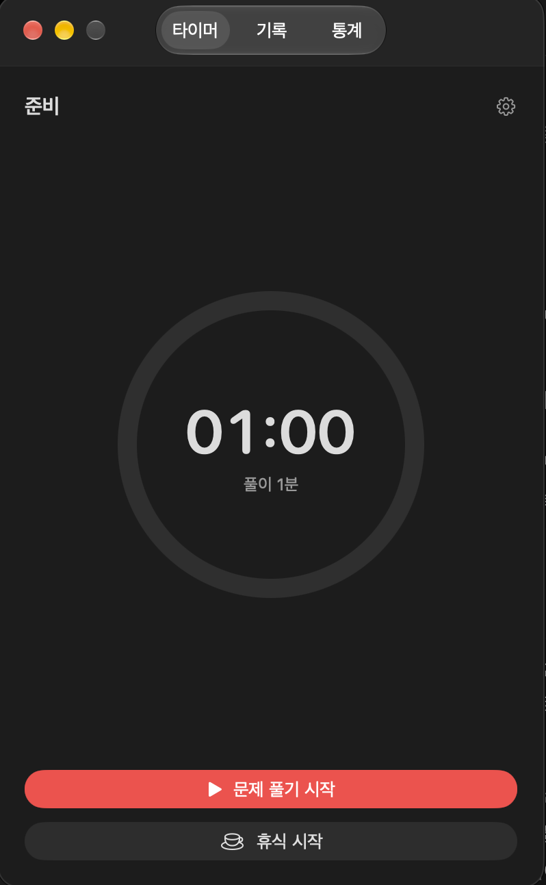
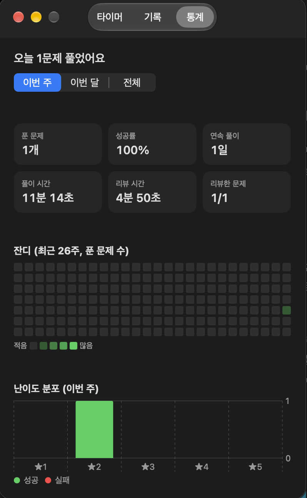

# 취준 포모도로 (JobPomodoro)

취업 준비용 macOS 포모도로 타이머입니다. 코테 포모도로(KotePomodoro)를 취준 전체로 넓혔습니다.
코테, 이력서·지원, 기업 분석, 면접 연습, 개인 프로젝트, 공부, 운동에 쓴 시간을 재고,
카테고리별 목표 대비 얼마나 했는지 통계로 봅니다.

> 스크린샷은 코테 포모도로 시절 화면입니다.

| 타이머 | 기록 | 통계 |
|---|---|---|
|  |  |  |

## 기능

- **카테고리**: 코테 · 이력서·지원 · 기업 분석·공고 · 면접 연습 · 개인 프로젝트 · 관련 공부 · 운동.
  이름·아이콘·색·순서를 바꾸거나 숨길 수 있고, 직접 추가할 수도 있어요.
- **타이머**
  - 카테고리마다 집중/휴식 시간이 따로 있어요 (코테 40/10, 프로젝트 50/10, 나머지 25/5).
  - 시간이 끝나면 `+5분`, `+10분`, `+15분`, 직접 입력 중에서 추가 시간을 고르거나 휴식합니다. 휴식이 끝나면 하던 일로 돌아옵니다. 기록되는 시간에는 휴식 시간이 빠집니다.
  - 운동은 끝나는 시간 없는 스톱워치로 잽니다.
  - 타이머 없이 한 일은 **직접 기록**으로 남깁니다.
- **카테고리별 기록 양식**

  | 카테고리 | 남기는 것 |
  |---|---|
  | 코테 | 성공/실패, 알고리즘 유형, 난이도, 코드 리뷰 시간 |
  | 이력서·지원 | 작업(이력서/자소서/포트폴리오/제출), 회사·직무, 작성 중/제출 완료 |
  | 기업 분석·공고 | 활동, 회사, 찾은 공고 수, 관심/지원 예정/패스 |
  | 면접 연습 | 종류(인성/기술/PT/모의면접), 자신감, 회사, 연습한 질문 수 |
  | 개인 프로젝트 | 한 일, 프로젝트, 진행 중/완료 |
  | 관련 공부 | 주제(운영체제, 네트워크 …), 이해도, 자료 |
  | 운동 | 종류, 강도 |

- **할 일**: 카테고리와 마감일을 붙여 할 일을 적고, ▶로 그 할 일의 타이머를 시작합니다. 기록이 할 일에 연결되어 할 일마다 쓴 시간이 보입니다. 마감이 가까우면 D-day가 표시돼요.
- **목표 탭**: 카테고리별로 이번 주 목표와 오늘 목표를 정하고 진행을 봅니다. 오늘 목표를 채우면 이번 주에 얼마가 남는지 보여주고, 남은 주간 목표 ÷ 남은 날로 오늘 목표를 추천합니다.
- **통계**: 이번 주, 이번 달, 전체 기간별로 볼 수 있습니다.
  - 카테고리별 시간, 날짜별 집중 시간 막대, 최근 26주 잔디
  - 카테고리를 누르면 자세한 통계 (유형별·회사별 시간, 결과, 별점 평균, 코테는 성공률·난이도 분포·리뷰 시간)
- **소리 없는 알림**: 시간이 끝날 때마다 mac 알림 배너가 뜨고 Dock 아이콘이 튑니다.

## 기술

SwiftUI · SwiftData · Swift Charts · UserNotifications · App Sandbox

| 파일 | 역할 |
|---|---|
| `TimerModel.swift` | 타이머 상태. 실제 시각(`Date`) 기준으로 계산해서 잠자기 모드 후에도 정확함 |
| `Notifier.swift` | 끝나는 시각에 맞춰 미리 예약하는 무음 알림 |
| `Models.swift` | 카테고리, 기록, 선택지, 할 일 (SwiftData) |
| `CategoryForm.swift` | 카테고리 종류별 기록 양식과 기본 카테고리 |
| `DataMigration.swift` | 기본값 채우기, 코테 포모도로 기록 옮기기 |
| `TimerView.swift` / `SessionSheet.swift` | 타이머 화면, 기록 입력 창 |
| `TodoView.swift` | 할 일 목록 |
| `HistoryView.swift` | 기록 목록, 리뷰 스톱워치 |
| `GoalView.swift` | 목표 탭 (이번 주·오늘 목표) |
| `StatsView.swift` / `CategoryStatsView.swift` | 기록 통계, 카테고리별 통계 |
| `SettingsView.swift` | 카테고리·타이머 설정 |

## 빌드와 설치

필요한 것: macOS, Xcode, Apple ID(무료로 충분)

1. Xcode → Settings → Accounts에서 Apple ID로 로그인합니다.
2. `Local.xcconfig.example`을 `Local.xcconfig`로 복사하고 본인 Team ID를 넣습니다. 이 파일은 git에 올라가지 않습니다.
3. 아래 명령을 실행합니다.

   ```bash
   ./scripts/install.sh
   ```

   배포용(Release)으로 빌드해서 `~/Applications/JobPomodoro.app`에 설치하고 실행합니다.

> Xcode에서 Signing & Capabilities의 Team을 직접 고르면 Team ID가 프로젝트 파일에 저장됩니다.
> 커밋하기 전에 `project.xcproj`에 `DEVELOPMENT_TEAM`이 들어가지 않았는지 확인하세요.

## mac 알림이 안 뜰 때

알림 권한 요청이 `Notifications are not allowed for this application`으로 거부되면 아래 세 가지를 확인하세요.

1. **서명**: 임시(ad-hoc) 서명이 아니라 Apple Development 인증서로 서명해야 합니다. Xcode에 Apple ID를 등록하면 됩니다.
2. **번들 ID**: Xcode가 붙이는 임시 ID(`devplaceholder…`)가 아닌 정식 ID여야 합니다.
3. **설치 위치**: 앱이 임시 폴더(`/private/tmp`처럼)에 있으면 macOS 알림 서비스가 앱을 인식하지 못합니다. `~/Applications`에 설치해야 합니다.

`scripts/install.sh`가 세 가지를 모두 처리합니다.

## 데이터

기록은 앱 샌드박스 폴더 `~/Library/Containers/app.jobpomodoro.JobPomodoro/`에만 저장됩니다.
외부로 전송되지 않습니다.

### 코테 포모도로 기록 옮기기

코테 포모도로를 쓰던 경우, 취준 포모도로를 한 번 설치·실행한 뒤 아래 명령으로 기록을 옮깁니다.
두 앱의 저장소를 `~/Documents/JobPomodoro-backup-…`에 백업한 다음 복사하고, 앱을 켜면 문제 기록이 '코테' 기록으로 바뀝니다.

```bash
./scripts/migrate-from-kote.sh
```
